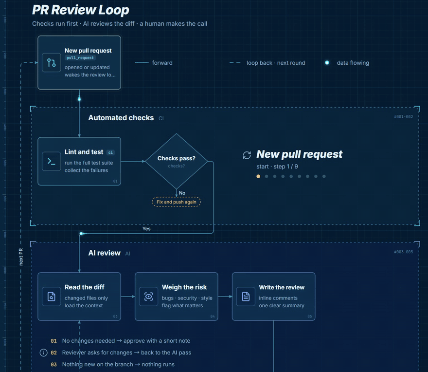
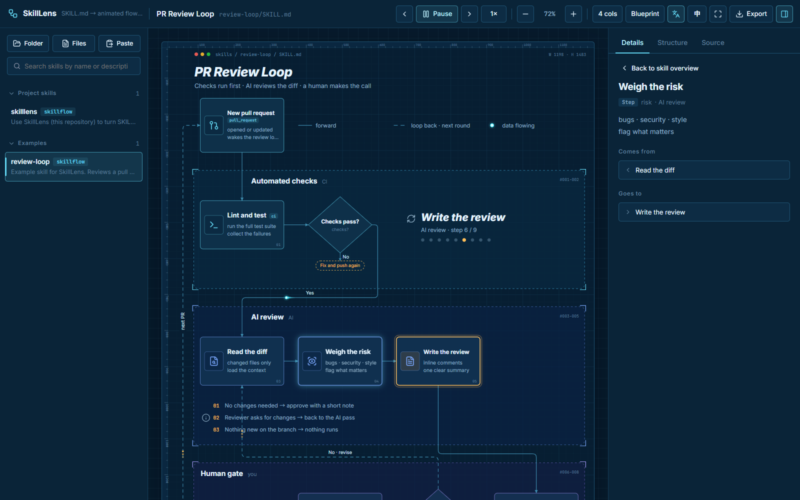
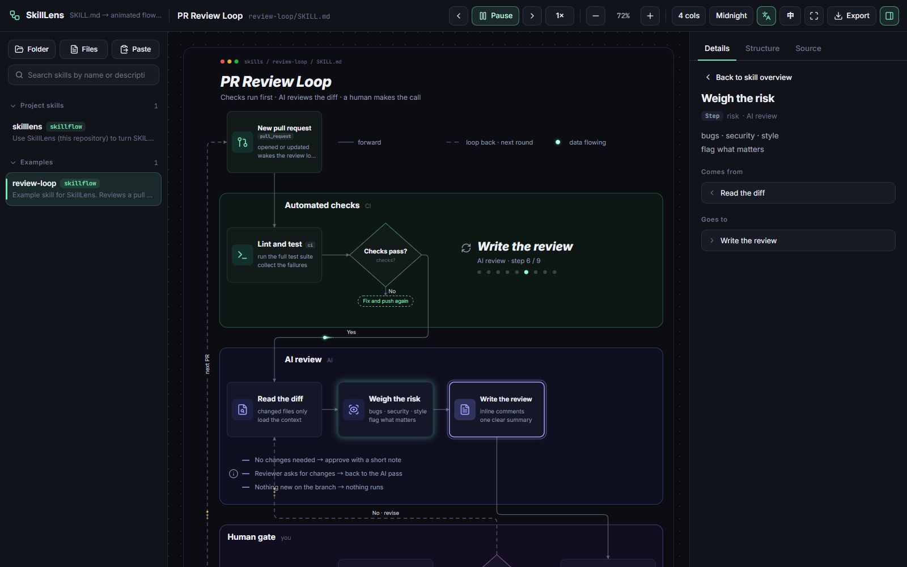
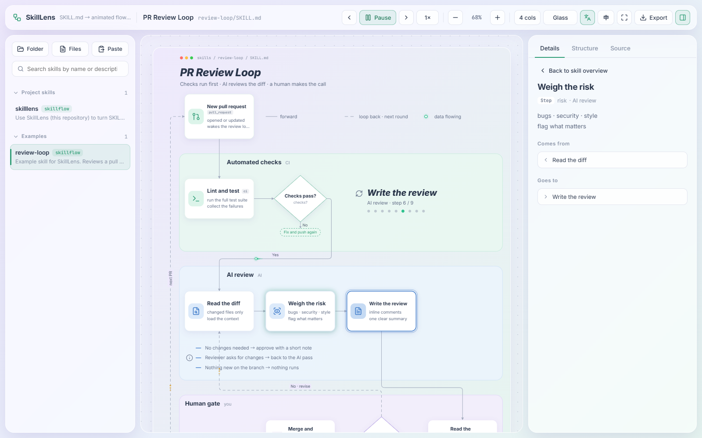
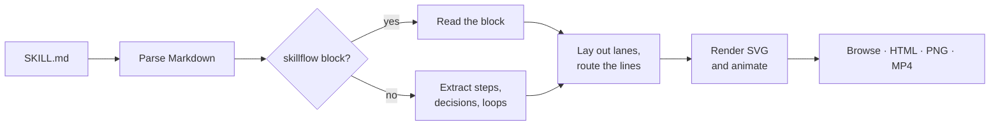

<div align="center">


# SkillLens

**Turn any `SKILL.md` into an animated flowchart.**

Drop in an agent skill and watch its workflow come alive: steps, decisions and loops are extracted automatically and drawn as a live swimlane diagram you can browse, tweak and export.

[](LICENSE)
[](https://nodejs.org)
[](package.json)
[](README.zh-CN.md)

**English** · [简体中文](README.zh-CN.md)

<br>



</div>

## Why SkillLens

Skills are long Markdown files. The workflow is in there, but you have to read every line to see it: which steps run in order, where the agent decides, what loops back. SkillLens reads the file for you and shows the shape of the work.

- **No changes to your skills.** Point it at a folder and every `SKILL.md` is charted on its own.
- **See it move.** The current step lights up and data dots travel along the lines, round after round, through every branch.
- **Pin it when it matters.** Fix the chart in the editor and paste it back into the skill as a `skillflow` block; from then on it draws exactly that.

## Features

| | |
| --- | --- |
| **Automatic extraction** | Sections become lanes, ordered lists and numbered headings become steps, "If …" becomes a decision, "go back to step N until …" becomes a loop, rules become notes, references become a side lane. |
| **Animated playback** | Every frame is a pure function of time, so playback can pause, step and seek, and videos record frame-perfect. |
| **Your whole library** | Lists the repo's skills plus your local Claude user and plugin skills, redraws within 2 seconds of a save, and imports any folder by drag and drop. |
| **Read the source** | Click a card to see its original text and where it comes from and goes to. |
| **`skillflow` blocks** | A small text format for exact control over lanes, cards, decisions and lines. |
| **Export** | Standalone animated HTML (one file, double-click to view), SVG, 2× PNG and MP4 video. |
| **Three themes** | Blueprint (default), Midnight and Glass, with Inter, Noto Sans SC and JetBrains Mono. |
| **English and Chinese** | Switch the UI with one click; chart text is auto-translated to match, using your local Claude Code or the Anthropic API. |

## Themes

<table>
  <tr>
    <td align="center"><br><sub><b>Blueprint</b> · default</sub></td>
    <td align="center"><br><sub><b>Midnight</b></sub></td>
    <td align="center"><br><sub><b>Glass</b></sub></td>
  </tr>
</table>

## Quick start

You need [Node.js](https://nodejs.org) 22 or newer. Video export also needs Chrome or Edge, and [ffmpeg](https://ffmpeg.org).

```bash
git clone https://github.com/noeigenstate/SkillLens.git
cd SkillLens
npm start
```

On Windows you can double-click **`start.bat`** instead (`启动.bat` opens the Chinese UI). There is nothing to install: SkillLens has no dependencies. Your browser opens with every skill it found.

Prefer no server? Run `npm run scan` once, then open `index.html` directly.

**Keyboard:** <kbd>Space</kbd> play / pause · <kbd>←</kbd> <kbd>→</kbd> step · <kbd>+</kbd> <kbd>-</kbd> zoom · <kbd>0</kbd> fit · <kbd>F</kbd> present · <kbd>Ctrl</kbd> + wheel zoom · drag to pan

## How it works



## Make your skill chart well

Auto-extraction follows the structure of the file. These habits give the best charts:

1. Put the procedure under `## Workflow` (or `## Steps`, `## Process`) as an ordered list, one `**Short title**: explanation` per step.
2. Start decisions with "If …"; `If X, do Y` becomes a diamond with an exit.
3. Write loops as "go back to step N until …".
4. Keep rules under `## Rules` and background under `## Reference`.

For full control, add a `skillflow` block. The quickest way is to fix the chart in the **Structure** panel and click **Copy as code block**:

```skillflow
title: My skill
trigger start: When to use [When] {bell}
  short description line

lane L1: Main flow [steps] (green)
  step a: First step [tag] {play}
    one or two lines of detail
  decide b: Needs review?
  step c: Ship it {send} +end

flow:
  start -> a -> b
  b -> c : No
  b ~> a : Yes · revise
```

`->` is a forward line, `~>` a dashed loop, `a -> "text" : Yes` an exit to a note. The full syntax is in [skills/skilllens/SKILL.md](skills/skilllens/SKILL.md), and [examples/review-loop](examples/review-loop/SKILL.md) uses every element.

## Commands

| Command | What it does |
| --- | --- |
| `npm start` | Local server with live reload, translation and in-page video recording |
| `npm run start:project` | Same, listing only this repo's skills |
| `npm run scan` | Writes `data/skills.js` so `index.html` works without a server |
| `npm run record -- <skill> [--seconds 30] [--scale 2] [--theme blueprint\|dark\|light] [--lang en\|zh]` | Records an MP4 into `output/` |

## Configuration

| Setting | Purpose |
| --- | --- |
| `--root Name=<path>` or `skillviz.config.json` | Scan more folders: `{"roots":[{"label":"Team skills","dir":"<path>"}]}` |
| `--no-claude` | Skip the local Claude user and plugin skill folders |
| `SV_TRANSLATE=off` | Turn auto-translation off |
| `ANTHROPIC_API_KEY` + `npm install` | Translate through the Anthropic SDK instead of Claude Code (`SV_TRANSLATE_MODEL` picks the model) |
| `SV_CHROME`, `SV_FFMPEG`, `SV_CLAUDE` | Paths to Chrome / Edge, ffmpeg and the Claude Code binary when they are not found |

Translations are cached in `data/translations.json`, so each string is translated once.

## Project layout

```
index.html        the app
src/              parsing, extraction, layout, rendering, UI, strings (en / zh)
scripts/          scan, local server, video recording (no third-party packages)
skills/skilllens  the guide for using and changing SkillLens
examples/         example skills
docs/             logo, screenshots and the demo GIF
```

## Credits

The visual grammar follows the loop view of [live-panel-skill](https://github.com/ythx-101/live-panel-skill). Icons by [Lucide](https://lucide.dev) (ISC); see [THIRD_PARTY_NOTICES.md](THIRD_PARTY_NOTICES.md).

## License

[MIT](LICENSE)
