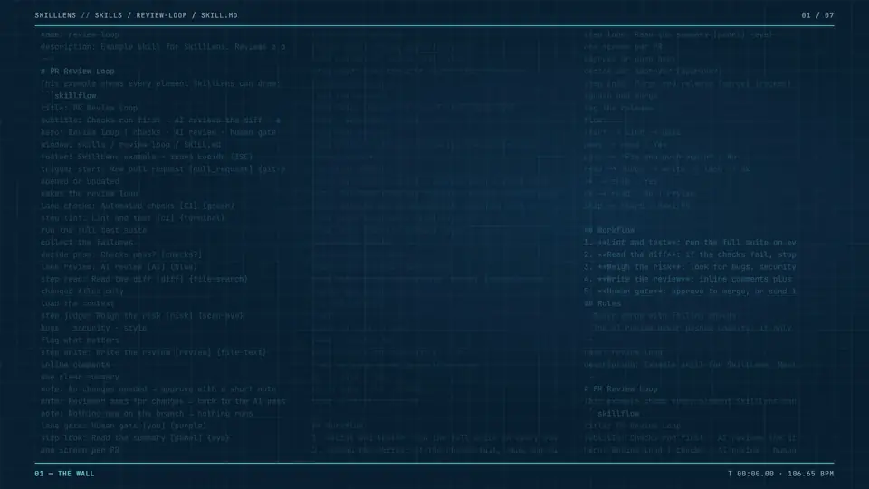
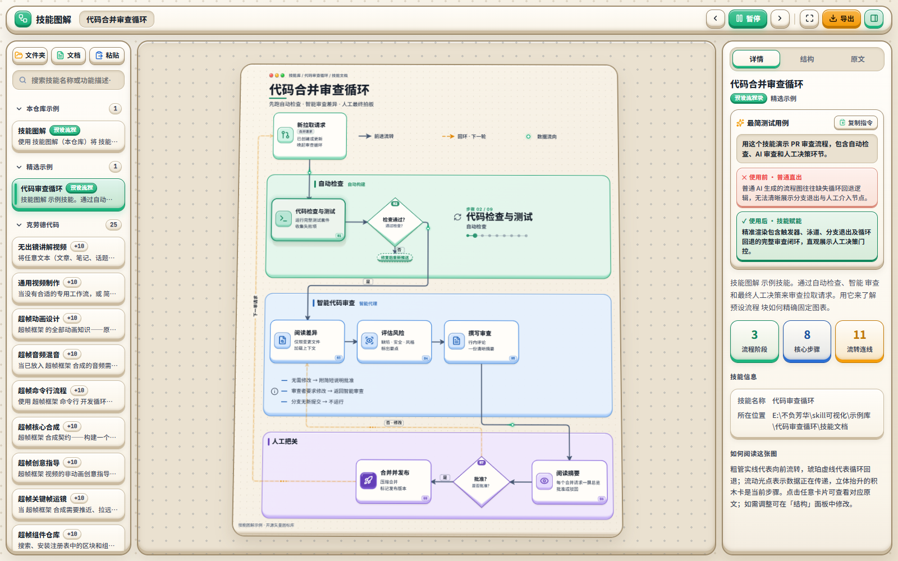
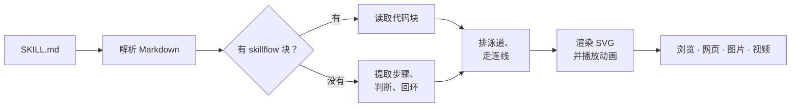

<div align="center">


# SkillLens

**把任意 `SKILL.md` 变成会动的流程图。**

丢进一个 skill，它的工作流就活起来：步骤、判断、回环自动提取，画成可以浏览、微调、导出的动态泳道图。

[](LICENSE)
[](https://nodejs.org)
[](package.json)
[](README.md)

[English](README.md) · **简体中文**

<br>

<a href="docs/promo.mp4"></a>

<sub>▶ <a href="docs/promo.mp4">观看带声音的 30 秒宣传片</a>（MP4，1080p）</sub>

</div>

## 为什么做 SkillLens

skill 是一份很长的 Markdown。工作流就写在里面，但要一行行读完才看得出：哪些步骤按顺序走，在哪里做判断，哪里会回头。SkillLens 替你读完，把工作的形状画出来。

- **不用改 skill。** 指向一个文件夹，里面每个 `SKILL.md` 都会自动出图。
- **看得见流动。** 当前步骤亮起，数据点沿线流动，一轮一轮走遍每条分支。
- **需要时可以固定。** 在编辑器里改好图，粘回 skill 成为 `skillflow` 代码块，之后就严格按它画。

## 功能

| | |
| --- | --- |
| **自动提取** | 章节变泳道；有序列表和编号小节变步骤；「如果…」变判断；「回到第 N 步，直到…」变回环；规则变注释；参考资料变侧边泳道。 |
| **动画播放** | 每一帧都由时间算出，可以暂停、逐步、拖动，录出来的视频逐帧准确。 |
| **整个技能库** | 列出本仓库和本机 Claude 用户 / 插件里的所有 skill；保存后 2 秒内自动重画；拖入任意文件夹即可导入。 |
| **看原文** | 点任意卡片，查看原文、从哪来、到哪去。 |
| **`skillflow` 代码块** | 一种小巧的文本格式，精确控制泳道、卡片、判断和连线。 |
| **导出** | 独立的动画网页（单个文件，双击即看）、SVG、2 倍 PNG、MP4 视频。 |
| **三套主题** | 蓝图（默认）、深夜、柔光；字体为 Inter、Noto Sans SC、JetBrains Mono。 |
| **中英双语** | 一键切换界面语言；图里的文字自动翻译成对应语言，用本机的 Claude Code 或 Anthropic API。 |

## 主题

<table>
  <tr>
    <td align="center"><br><sub><b>蓝图</b> · 默认</sub></td>
    <td align="center"><br><sub><b>深夜</b></sub></td>
    <td align="center"><br><sub><b>柔光</b></sub></td>
  </tr>
</table>

中文界面下，图里的步骤也会自动翻译成中文：



## 快速开始

需要 [Node.js](https://nodejs.org) 22 或更新版本；导出视频还需要 Chrome 或 Edge，以及 [ffmpeg](https://ffmpeg.org)。

```bash
git clone https://github.com/noeigenstate/SkillLens.git
cd SkillLens
npm start -- --lang zh
```

Windows 上直接双击 **`start.bat`**。界面默认英文，点顶栏的 **中** 按钮切到中文，之后会一直记住。不需要安装任何依赖。浏览器会自动打开，列出找到的所有 skill。

不想起服务：先运行一次 `npm run scan`，再直接双击 `index.html`。

**快捷键：** <kbd>空格</kbd> 播放 / 暂停 · <kbd>←</kbd> <kbd>→</kbd> 逐步 · <kbd>+</kbd> <kbd>-</kbd> 缩放 · <kbd>0</kbd> 适应宽度 · <kbd>F</kbd> 全屏演示 · <kbd>Ctrl</kbd> + 滚轮缩放 · 拖动画布平移

## 工作原理



## 让 skill 画得准

自动提取跟着文件结构走，这样写效果最好：

1. 流程写在 `## 流程` / `## Workflow` 下，用有序列表，每步写成 `**短标题**：说明`。
2. 判断用「如果…」开头；`如果 X，就做 Y` 会画成带出口的菱形。
3. 回环写成「回到第 N 步，直到…」。
4. 规则放在 `## 注意`，背景资料放在 `## 参考`。

要精确控制，就加一个 `skillflow` 代码块。最快的办法：在「结构」面板里改好，点「复制为代码块」。完整语法见 [skills/skilllens/SKILL.md](skills/skilllens/SKILL.md)，[examples/review-loop](examples/review-loop/SKILL.md) 用到了全部元素。

## 命令

| 命令 | 作用 |
| --- | --- |
| `npm start` | 本地服务：实时刷新、自动翻译、页面内录视频 |
| `npm run start:project` | 同上，只列本仓库的 skill |
| `npm run scan` | 生成 `data/skills.js`，不起服务也能打开 `index.html` |
| `npm run record -- <skill> [--seconds 30] [--scale 2] [--theme blueprint\|dark\|light] [--lang en\|zh]` | 录 MP4 到 `output/` |

## 配置

| 设置 | 作用 |
| --- | --- |
| `--root 名字=<路径>` 或 `skillviz.config.json` | 多扫一些目录：`{"roots":[{"label":"团队 skills","dir":"<路径>"}]}` |
| `--no-claude` | 不扫本机 Claude 的用户 / 插件 skill 目录 |
| `SV_TRANSLATE=off` | 关闭自动翻译 |
| `ANTHROPIC_API_KEY` + `npm install` | 用 Anthropic SDK 翻译，不用 Claude Code（`SV_TRANSLATE_MODEL` 指定模型） |
| `SV_CHROME`、`SV_FFMPEG`、`SV_CLAUDE` | 找不到 Chrome / Edge、ffmpeg、Claude Code 时指定路径 |

译文缓存在 `data/translations.json`，同一句话只翻一次。

## 致谢

视觉语法参考 [live-panel-skill](https://github.com/ythx-101/live-panel-skill) 的 loop 视图。图标来自 [Lucide](https://lucide.dev)（ISC），见 [THIRD_PARTY_NOTICES.md](THIRD_PARTY_NOTICES.md)。宣传片配乐：Ruskerdax 的《[Cybershaman](https://opengameart.org/content/cybershaman)》（CC0）。

## 许可证

[MIT](LICENSE)
